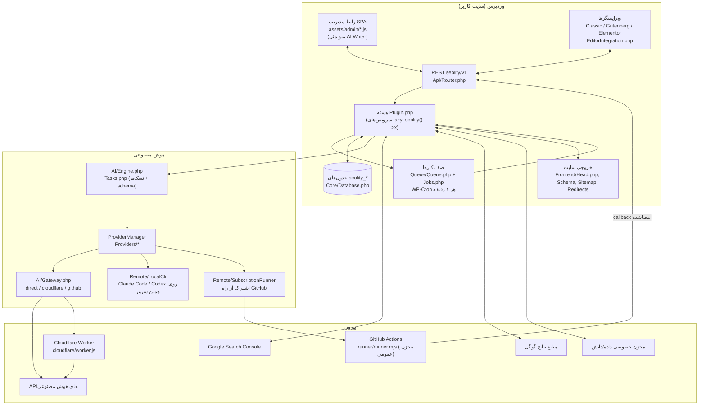
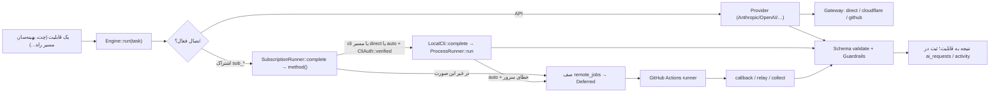
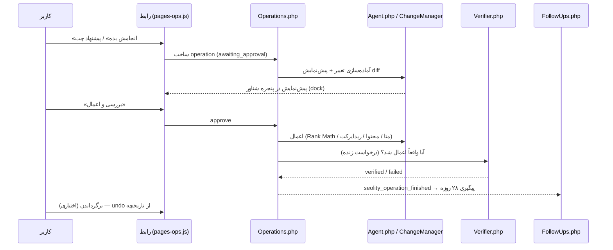
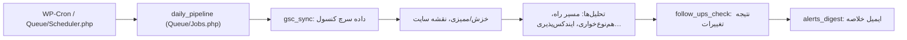
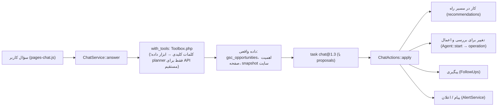
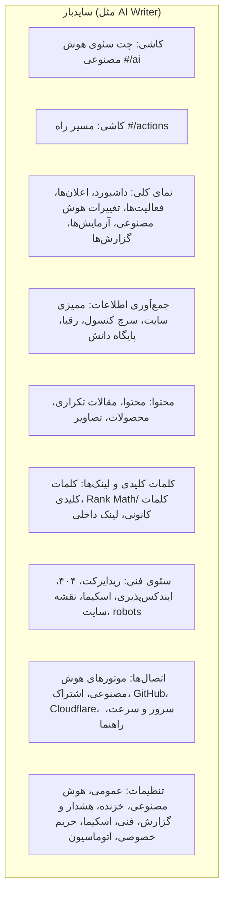

# SEOlity — توضیح جامع پروژه

## ۱. پروژه چیست؟
**ARIAGH.SEOLITY** (نام کد: SEOlity) یک افزونه وردپرس سئو با هوش مصنوعی است، فارسی و راست‌به‌چپ (RTL).
- سایت اصلی کاربر: **benlifood.ir**، فروشگاه محصولات تخمیری با **Rank Math + Elementor + WooCommerce**.
- هدف: هر روز به صاحب سایت بگوید «امروز چه کار کنم؟» (مسیر راه)، مشکلات سئو را با داده واقعی (سرچ کنسول، خزش سایت، رقبا) پیدا کند و اصلاح‌ها را **فقط با تأیید کاربر** انجام دهد. هر اصلاح پیش‌نمایش، تأیید، اجرا، راستی‌آزمایی و امکان برگشت دارد.
- خواهر این افزونه: **ARIAGH.AIWRITER**، نویسنده خودکار مقاله و افزونه قبلی همین کاربر. شاخه `main` این مخزن و `runner/runner.mjs` در ریشه مال آن است. ظاهر و منوی SEOlity کپی آن است.

### فناوری
| لایه | انتخاب |
|---|---|
| سرور | PHP ≥ 7.4، فضای نام PSR-4 `SEOlity\` با autoloader خودش (`src/Autoloader.php`، بدون Composer) |
| رابط مدیریت | SPA بدون build، جاوااسکریپت خالص در `assets/admin/*.js`، با مسیرهای `#/slug` |
| API | REST وردپرس با فضای نام `seolity/v1` (`src/Api/Router.php`) |
| کارهای پس‌زمینه | صف داخلی روی جدول `jobs` + WP-Cron یک‌دقیقه‌ای (`src/Queue/*`) |
| هوش مصنوعی | API مستقیم (Anthropic, OpenAI, Gemini, OpenRouter, Ollama, GitHub Models, API سفارشی) یا **اشتراک** Claude Pro/Max و ChatGPT Plus/Pro از راه CLI رسمی (روی همین سرور یا GitHub Actions) |
| شبکه | مسیرهای Direct / Cloudflare relay / GitHub، با توجه به ایران یا خارج بودن سرور |
| داده بیرونی | Google Search Console (OAuth + PKCE)، PageSpeed، منابع نتایج گوگل (Serper, SerpApi, …) |
| ذخیره سرد | مخزن خصوصی GitHub برای دانش و آرشیو داده؛ مخزن عمومی برای اجراکننده |

## ۲. نمودار کلی معماری

## ۳. جریان یک درخواست هوش مصنوعی

نکته‌ها:
- **auto** فقط وقتی از CLI محلی استفاده می‌کند که «آزمایش اتصال» روی همین سرور موفق شده باشد (`CliAuth::verified`). در غیر این صورت درخواست به GitHub می‌رود.
- `Deferred` یعنی پاسخ بعداً می‌رسد و کار در صف منتظر می‌ماند.
- هر تسک در `AI/Tasks.php` نسخه دارد (مثل `chat@1.3`) و خروجی آن با JSON-Schema بررسی می‌شود (`AI/Schema.php`).

## ۴. جریان «اصلاح» (هیچ چیز بدون تأیید اعمال نمی‌شود)

## ۵. چرخه روزانه

## ۶. چت هوش مصنوعی

## ۷. پایگاه داده
همه جدول‌ها با پیشوند `{wp_prefix}seolity_` در `src/Core/Database.php` تعریف شده‌اند. ارتقای نسخه پایگاه داده در `src/Core/Installer.php` است و نسخه فعلی **1.7.0** است (`SEOLITY_DB_VERSION` در `seolity.php`).

| گروه | جدول‌ها |
|---|---|
| خزش و ممیزی | `projects`, `urls`, `audits`, `issues`, `content_analysis`, `images`, `internal_links` |
| سرچ کنسول | `gsc_daily`, `gsc_page_query` (page_hash=`Database::url_hash`, query_hash=`Database::hash`), `gsc_breakdown`, `keywords` |
| رقبا و نتایج گوگل | `competitors`, `competitor_pages`, `serp_snapshots`, `serp_results`, `serp_analyses` |
| تغییرات و عملیات | `changes`, `operations`, `experiments`, `learnings`, `redirects`, `not_found` |
| مسیر راه و هشدار | `recommendations`, `roadmaps`, `alerts`, `reports`, `rules` |
| هوش مصنوعی | `ai_requests`, `ai_cache`, `chat`, `knowledge`, `remote_jobs`, `content_plan`, `clusters` |
| سیستم | `jobs` (صف)، `audit_log`، `activity` (ستون نوع = `kind`) |

داده‌هایی که در option وردپرس نگه داشته می‌شوند (بدون جدول): `seolity_settings`، `seolity_follow_ups` (حداکثر ۳۰۰)، `seolity_cli_auth`، `seolity_cli_install_{engine}`، `seolity_mail_last`، transient `seolity_node_scan`.

## ۸. رابط کاربری (SPA)
- بارگذاری در `src/Admin/Admin.php::assets()`: `editor.css`، `app.css`، `charts.js`، `ui.js` (کامپوننت‌ها و آیکون‌ها، `SL.*`)، `app.js` (پوسته، مسیریاب، داشبورد، `App.*`) و بعد همه `pages-*.js`.
- پیکربندی از PHP به JS با `window.SEOLITY` (`Admin::js_config`) فرستاده می‌شود: `routes`، `nav`، `i18n`، `brand`، `rtl` و غیره. این پیکربندی هیچ رمزی ندارد.
- **منو (از 1.15.0):** هم منوی وردپرس و هم سایدبار برنامه از یک منبع ساخته می‌شوند: `Admin::nav()`. گروه `main` به شکل دو کاشی بزرگ (چت و مسیر راه) نمایش داده می‌شود و بقیه صفحه‌ها آیتم‌های جدا زیر عنوان گروه هستند. «تب بخش» وجود ندارد.

- صفحه جدید = (۱) route در `Admin::routes()` (۲) جای آن در `Admin::nav()` (۳) آیکون در `ICONS` در `app.js` (۴) تابع `App.pages['slug']` در یکی از `pages-*.js` (۵) ترجمه.
- الگوی کارت بزرگ افقی: کلاس `.sl-mapcard` در `app.css`. کاشی سایدبار: `.sl-nav__tile`.
- تم تیره با `data-theme="dark"`؛ موبایل: سایدبار به کشوی کناری تبدیل می‌شود (زیر ۹۶۰px).

## ۹. امنیت
- رمزها با AES-256-GCM در دیتابیس ذخیره می‌شوند (`Core/Crypto.php`). ثابت `SEOLITY_ENCRYPTION_KEY` در wp-config توصیه می‌شود. رمزها هرگز به مرورگر برنمی‌گردند (فقط‌نوشتنی).
- دسترسی‌ها در `Core/Capabilities.php` تعریف شده‌اند: VIEW / AI / APPLY / MANAGE و نقش «SEOlity Client».
- callback اجراکننده GitHub با HMAC امضا می‌شود. داده بین سایت و اجراکننده رمزنگاری می‌شود (`runner/runner.mjs`).
- `Core/Http.php` جلوی SSRF را می‌گیرد. اجرای برنامه‌ها فقط از یک جا انجام می‌شود (`ProcessRunner`) و اسرار در خروجی پاک می‌شوند (`CliErrors::redact`).

## ۱۰. ترجمه
- رشته‌های JS با `t('English')` و رشته‌های PHP با `__('English','seolity')` نوشته می‌شوند. ترجمه فارسی در `tools/i18n/fa-*.tsv` است (آخرین فایل: `fa-19.tsv`).
- `python3 tools/i18n/build.py` این‌ها را می‌سازد: `src/Admin/I18n.php` (تولیدی، دستی ویرایش نشود)، `.pot`، `.po` و `.mo`.
- محدودیت‌ها: `_n()` استفاده نشود. در pages-admin.js، بین `var LABELS` و `App.pages.settings` هر رشته‌ای رشته ترجمه حساب می‌شود.

## ۱۱. چیزهایی که هنوز در دنیای واقعی آزمایش نشده‌اند
- ارسال واقعی ایمیل اعلان‌ها.
- «آزمایش اتصال» Codex/Claude روی هاست واقعی کاربر.
- اجرای GitHub بعد از عمومی شدن مخزن اجراکننده.
- منوی جدید 1.15.0 روی وردپرس واقعی (فقط در مرورگر شبیه‌سازی‌شده آزمایش شد).
- منابع بیرونی (Serper/SerpApi، Gemini grounding، …) فقط با داده نمونه هم‌شکل مستندات آزمایش شده‌اند.
